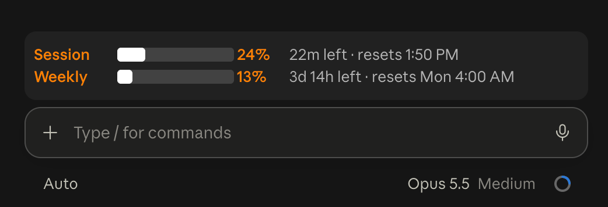

# usage-bar

Shows your 5-hour session and weekly usage limits in a band above the prompt, one row each: the label and percentage in `#FF8200`, a white meter, and the time left until reset in light gray.



In a terminal the meter is drawn with text:

```
Session  ██░░░░░░░░  24% 2h 13m left · resets 3:40 PM
Weekly   ████░░░░░░  41% 3d 12h left · resets Mon 4:00 AM
```

## Install

Run these in any terminal, then restart Claude Code:

```bash
claude plugin marketplace add dookers-code/dooks-mods
```

```bash
claude plugin install usage-bar@dooks-mods
```

To update later, run `claude plugin marketplace update dooks-mods`, then `claude plugin update usage-bar@dooks-mods`.

## Toggle

Run `/usage-bar` to hide or show the band. The choice is remembered across sessions.

## Notes

- The figures are the ones Claude Code receives with each API response, so the band appears after the first reply in a session and updates whenever a window moves a whole point. A response that carries no figures leaves the last reading in place.
- Only shows on a Claude subscription. API-key sessions report no rate limits, so the band stays hidden.
- Mods can't draw in the desktop app's sidebar, so the band sits above the prompt instead.
- The time left counts down once a minute.
